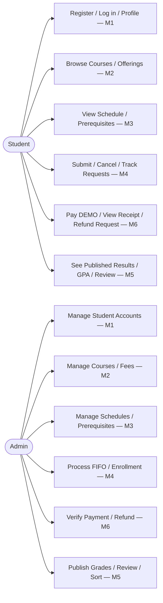
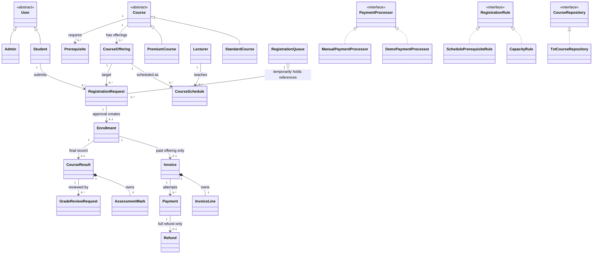
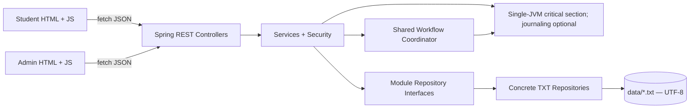
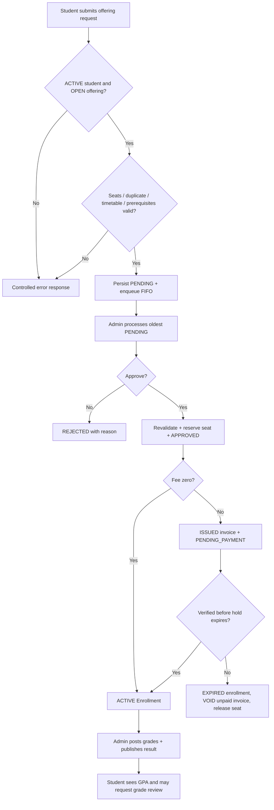

# NO-CODE UML, NOUN–VERB ANALYSIS AND CRC CARDS — FROZEN v0.2

Diagrams are planning sketches, not compiled Java code. Mermaid blocks can be pasted into a Mermaid-capable renderer or converted into actual diagrams during later implementation. Cardinalities and important relationships are explained below.

## 1. Noun–Verb Analysis

**Nouns suggest classes/data**: Student, Admin, User, Course, CourseOffering, Lecturer, CourseSchedule, Prerequisite, RegistrationRequest, Enrollment, Invoice, InvoiceLine, Payment, Refund, CourseResult, AssessmentMark, GradeReviewRequest, RegistrationQueue.

**Verbs suggest responsibilities/services**: authenticate, publish, schedule, check prerequisite, submit request, enqueue, approve/reject, reserve seat, invoice, verify, activate, expire, publish results, calculate GPA, sort registration times.

**Avoid wrong equivalences**: RegistrationRequest is NOT an Enrollment. Enrollment is NOT an Invoice. Invoice is NOT a Payment. Payment is NOT a CourseResult. This separation is essential for the TXT writer ownership and UML.

## 2. CRC Cards — Class / Responsibilities / Collaborators

| Class | Main responsibilities | Collaborators |
|---|---|---|
| `Student` (M1) | identity/status, encapsulated profile and student privileges | abstract `User`, `StudentService` |
| `CourseOffering` (M2) | term, fee, capacity, registration open interval | `Course`, M4 read-only seat count |
| `PrerequisiteService` (M3) | rule CRUD, no graph cycles, check published pass | `Prerequisite`, `PassedCoursePort` (M5) |
| `RegistrationQueue` (M4) | enqueue PENDING requests, FIFO peek/poll, rebuild from persisted `sequenceNo` | `RegistrationRequestRepository`, `RegistrationRequest` |
| `EnrollmentLifecycleService` (M4) | reserve, activate, expire, withdraw while owning enrollment TXT | `EnrollmentRepository`, `EnrollmentPaymentPort`, coordinator |
| `ResultService` (M5) | draft/publish, weighted marks, GPA, official passing view | `CourseResult`, `AssessmentMark`, `EnrollmentReadPort` |
| `Invoice` (M6) | immutable invoice and line snapshot | owned `InvoiceLine`, `InvoiceService` |
| `PaymentService` (M6) | idempotency, verified payment, coordinate activation | `PaymentProcessor`, `InvoiceService`, `EnrollmentPaymentPort` |

## 3. Use Cases (two actors, six features)



## 4. Major UML Class Relationships



**Symbols explained:** hollow triangle points to parent (`Student` **is a** `User`, `extends`); dotted realization points to interface (`TxtCourseRepository` **implements** `CourseRepository`); `*--` black diamond = composition, owned child lifecycle (`InvoiceLine` cannot outlive `Invoice`); `o--` white diamond = aggregation (`RegistrationQueue` can lose/rebuild its references without destroying persisted requests); `-->` ordinary association (links through stable IDs, no ownership).

## 5. Component Architecture



## 6. Registration + Payment Sequence Diagram

```mermaid
sequenceDiagram
  actor Student
  participant M4 as M4 Registration
  participant E as M3 Eligibility
  participant Q as M4 FIFO Queue
  actor Admin
  participant M6 as M6 Invoice / Payment
  Student->>M4: POST /students/me/requests(offeringId)
  M4->>E: assertEligible(studentId, offeringId)
  E-->>M4: pass or controlled 409
  M4->>Q: persist PENDING and enqueue
  M4-->>Student: 201 PENDING + sequenceNo
  Admin->>M4: decide next FIFO (APPROVE)
  M4->>Q: peek oldest under global lock
  M4->>M4: recheck eligibility, hold seat, create enrollment
  M4->>M6: issueOnce(enrollmentId, fee snapshot)
  M6-->>M4: invoiceId ISSUED
  M4-->>Admin: APPROVED + enrollmentId + invoiceId
  Student->>M6: demo pay(invoiceId, idempotencyKey)
  M6->>M6: validate amount, status, idempotency, hold
  M6->>M4: activateAfterVerifiedPayment()
  M4-->>M6: ACTIVE enrollment
  M6-->>Student: VERIFIED + receipt; invoice PAID
```

This sketch shows the happy paid path. A zero-price offering activates without calling M6. The v0.2 student project does not implement mandatory journaling or automatic cross-file restart recovery. Failed partial operations require explicit detection and manual reconciliation before retry. M6 **never** edits M4 enrollment TXT directly.

## 7. Activity / Decision Flow



## 8. Edge cases and suggested tests

1. Registration for inactive student → 403/409 controlled, no request written.
2. No prereq rules → eligibility succeeds if other checks pass; one unmet active rule → 409; duplicate/self/circular edges → rejected.
3. Two students race for last seat → only one approval makes `PENDING_PAYMENT`/ACTIVE; the other must be rejected/left pending under policy, no overbooking.
4. Request A, B, C → dequeue A before B before C; restarting reconstructs same order from unique sequenceNo.
5. Payment retried with same idempotency key → return original outcome, no second verified payment or duplicate enrollment activation.
6. Invoice amount unaffected by admin changing offering fee after issuance.
7. Result DRAFT not visible to student; PUBLISHED is visible and counted toward GPA.
8. Insertion Sort test with out-of-order timestamps and ties; input remains based on request time and sequence number, not GPA.
9. Malformed TXT header/field → controlled file error; no silent row loss. Restart persistence is tested; failed partial multi-file transactions are documented and handled through a manual reconciliation procedure (no automatic coordinator replay required).
10. Student A cannot read student B's invoice/receipt/results; student may not call admin endpoints.
